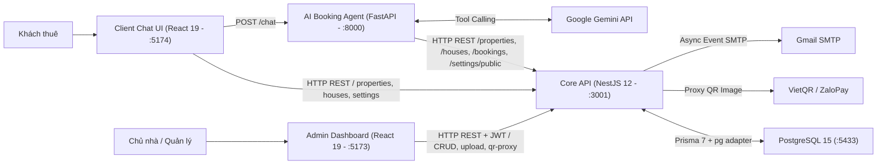

# DRLAND — Hệ Thống Quản Lý Phòng Trọ, Mặt Bằng & Trợ Lý AI Đặt Lịch (CTPT Monorepo)


Giải pháp phần mềm **Polyglot Monorepo** quản lý bất động sản cho thuê đa tòa nhà (phòng trọ và mặt bằng kinh doanh), kết hợp **Trợ lý AI (Google Gemini + LangChain)** tư vấn phòng trống và đặt lịch xem phòng 24/7, cùng phân hệ quản trị hợp đồng OpenXML (`.docx`), tính hóa đơn điện nước theo chỉ số kỳ trước và sinh mã VietQR/ZaloPay tự động.

---

## Mục Lục

1. [Demo Trực Tuyến (Railway Cloud 24/7)](#demo-trực-tuyến-railway-cloud-247)
2. [Tính Năng Chính](#tính-năng-chính)
3. [Kiến Trúc Hệ Thống](#kiến-trúc-hệ-thống)
4. [Công Nghệ Sử Dụng](#công-nghệ-sử-dụng)
5. [Cơ Sở Dữ Liệu & API Chính](#cơ-sở-dữ-liệu--api-chính)
6. [Cấu Trúc Thư Mục Monorepo](#cấu-trúc-thư-mục-monorepo)
7. [Hướng Dẫn Cài Đặt & Khởi Chạy Local](#hướng-dẫn-cài-đặt--khởi-chạy-local)
8. [Kiểm Thử & Kiểm Tra Chất Lượng](#kiểm-thử--kiểm-tra-chất-lượng)
9. [Triển Khai & Sao Lưu Dữ Liệu](#triển-khai--sao-lưu-dữ-liệu)
10. [Tài Liệu Đặc Tả & Tác Giả](#tài-liệu-đặc-tả--tác-giả)

---

## Demo Trực Tuyến (Railway Cloud 24/7)

Hệ thống đã được triển khai cố định gồm 5 dịch vụ (`Postgres`, `core-api`, `ai-booking-agent`, `client-chat-ui`, `admin-dashboard`) trên **Railway Cloud**:

| Dịch vụ / Giao diện | Mô tả | Đường dẫn truy cập |
| :--- | :--- | :--- |
| **Trang Khách Thuê (`client-chat-ui`)** | Tra cứu phòng/mặt bằng theo tòa nhà & chat đặt lịch | [client-chat-ui-production.up.railway.app](https://client-chat-ui-production.up.railway.app) |
| **Trang Quản Trị (`admin-dashboard`)** | Quản lý tòa nhà, phòng thuê, hợp đồng `.docx`, hóa đơn, lịch hẹn | [admin-dashboard-production-df3d6636.up.railway.app](https://admin-dashboard-production-df3d6636.up.railway.app) |
| **Core Backend API (`core-api`)** | Swagger OpenAPI 3.0 & REST API trung tâm | [core-api-production-c5118cb8.up.railway.app/api/docs](https://core-api-production-c5118cb8.up.railway.app/api/docs) |
| **AI Booking Agent (`ai-booking-agent`)** | Health check & FastAPI service | [ai-booking-agent-production-c251525f.up.railway.app/health](https://ai-booking-agent-production-c251525f.up.railway.app/health) |

---

## Tính Năng Chính

### 1. Cổng Khách Thuê & Trợ Lý AI (`client-chat-ui` + `ai-booking-agent`)
- **Đồng bộ thông tin trực tiếp theo tòa nhà:** Hiển thị danh sách cơ sở đang vận hành (`Tòa Nhà 14B8 Ngô Tất Tố`, `Tòa Nhà 14B9 Ngô Tất Tố`), trạng thái phòng trống/sắp trống, hình ảnh thực tế, hotline, Zalo và giờ xem phòng đồng bộ từ Cài đặt hệ thống.
- **Tư vấn & đặt lịch 24/7 qua LangChain ReAct + Gemini:** Hỗ trợ tìm kiếm phòng theo loại (`ROOM` / `COMMERCIAL_SPACE`), mức giá và quy đổi thời gian tương đối (*"chiều mai 2h"*, *"sáng mai 9h"*) theo múi giờ Việt Nam (`UTC+7`).
- **Bảo vệ đặt lịch đa tầng (Booking Guardrails):**
  - Chặn đặt lịch sớm khi khách chưa cung cấp đủ Tên thật & SĐT; chặn đại từ giữ chỗ (*"Anh/Chị"*, *"Khách hàng"*, *"Chưa rõ"*, tên toàn chữ số...).
  - Chặn sử dụng nhầm Hotline/Zalo của chủ nhà làm SĐT khách và kiểm chứng SĐT thật có xuất hiện trong nội dung khách đã nhắn (`phone_appeared_in_texts`).
  - Chống tạo đơn trùng theo cả `session_id` lẫn khóa `(propertyId, phoneNumber, desiredMoveIn)` ở backend; hỗ trợ cập nhật giờ mới khi khách dời lịch.
  - **Failover nhiều tầng:** Tự động luân chuyển giữa các model Gemini (`gemini-3.5-flash-lite` -> `gemini-3.1-flash-lite` -> `gemini-3.5-flash`) và kích hoạt kịch bản phản hồi dự phòng từ `core-api` khi hết quota.

### 2. Cổng Quản Trị Chủ Nhà (`admin-dashboard`)
- **Quản lý đa tòa nhà & 4 trạng thái phòng:** Theo dõi `AVAILABLE`, `SOON_TO_BE_AVAILABLE`, `DEPOSITED`, `RENTED`; cảnh báo phòng sắp hết hạn hợp đồng và phòng đến ngày nghiệm thu bàn giao.
- **Xuất hợp đồng thuê OpenXML (`.docx`) & PDF:** Sinh file Word `.docx` chuẩn khổ A4 đầy đủ **7 điều khoản** theo Bộ luật Dân sự 2015 & Luật Nhà ở 2023, tự động đọc tiền bằng chữ tiếng Việt và kế thừa chỉ số điện nước bàn giao.
- **Tự động hóa hóa đơn điện nước & QR thanh toán:** Nhắc phòng đến kỳ ghi số, tự động kế thừa chỉ số điện/nước cuối kỳ trước, tính tiền bằng `Prisma.Decimal`, lập hóa đơn hàng loạt, xuất CSV, in phiếu thu và tạo mã VietQR / ZaloPay động thông qua proxy nội bộ.
- **Quản lý lịch hẹn & Cài đặt hệ thống:** Hiển thị rõ ngày & giờ hẹn (`YYYY-MM-DD • HH:MM`), nút gọi điện / mở Zalo 1 chạm, lọc theo trạng thái và quản trị tập trung thông tin liên hệ, tài khoản nhận tiền, đổi mật khẩu.

### 3. Core Backend & Bảo Mật (`core-api`)
- Kiến trúc module NestJS rõ ràng (`AuthModule`, `HousesModule`, `PropertiesModule`, `BillingModule`, `BookingsModule`, `NotificationsModule`, `SettingsModule`, `PrismaModule`).
- Xác thực JWT (`PassportStrategy`) + mã hóa mật khẩu bằng `bcryptjs`, DTO validation nghiêm ngặt (`whitelist`, `forbidNonWhitelisted`).
- Giới hạn tần suất (`ThrottlerGuard`: tối đa 5 yêu cầu/phút/IP cho `POST /bookings`), lưu lịch hẹn idempotent tránh trùng lặp và gửi email thông báo bất đồng bộ qua `@OnEvent('booking.created', { async: true })` + Nodemailer.

---

## Kiến Trúc Hệ Thống



> **Nguyên tắc ranh giới kiến trúc:** Dịch vụ `ai-booking-agent` **tuyệt đối không kết nối trực tiếp** vào PostgreSQL. Mọi thao tác tra cứu phòng, thông tin tòa nhà, hotline và tạo lịch hẹn đều đi qua REST API của `core-api` để đảm bảo kiểm tra ràng buộc nghiệp vụ, rate limit và gửi email thông báo đồng nhất.

---

## Công Nghệ Sử Dụng

| Phân hệ | Công nghệ & Thư viện chính |
| :--- | :--- |
| **Backend (`core-api`)** | NestJS 12, TypeScript 6, Prisma ORM 7.10 (`@prisma/adapter-pg`), Passport JWT, `bcryptjs`, `class-validator`, `@nestjs/throttler`, `@nestjs/event-emitter`, Nodemailer, Swagger, Vitest 4, Oxlint |
| **AI Agent (`ai-booking-agent`)** | Python 3.10+, FastAPI, Uvicorn, LangChain (`create_tool_calling_agent`), `langchain-google-genai`, Pydantic v2, Requests, `unittest` |
| **Admin Portal (`admin-dashboard`)** | React 19, TypeScript, Vite 8, React Router 7, Tailwind CSS 3.4, Axios, `docx` (tạo OpenXML `.docx`), Lucide React, `tsx --test` |
| **Client Portal (`client-chat-ui`)** | React 19, TypeScript, Vite 8, React Router 7, Tailwind CSS 3.4, Axios, Lucide React |
| **Cơ sở dữ liệu & Hạ tầng** | PostgreSQL 15, Docker & Docker Compose (`prod` profile với Nginx), Railway Cloud |

---

## Cơ Sở Dữ Liệu & API Chính

### Lược đồ PostgreSQL (`core-api/src/prisma/schema.prisma`)
- `admins`: Tài khoản quản trị (`email`, `password_hash`, `full_name`).
- `houses`: Danh sách cơ sở/tòa nhà (`code`, `name`, `address`, đơn giá mặc định điện/nước/dịch vụ).
- `properties`: Phòng trọ & mặt bằng (`house_id`, `code`, `type`, `status`, diện tích, giá thuê/cọc `Decimal`, ảnh, thông tin khách thuê & thời hạn hợp đồng).
- `billings`: Hóa đơn theo kỳ (`property_id`, `period_year`, `period_month` với ràng buộc duy nhất `@@unique([propertyId, periodYear, periodMonth])`, chỉ số điện nước đầu/cuối, snapshot đơn giá, tổng tiền `Decimal(14,2)`, `status`).
- `booking_requests`: Lịch hẹn xem phòng (`property_id`, `customer_name`, `customer_phone`, `desired_move_in`, `message`, `source`, `status`, `notified_at`).
- `system_settings`: Cấu hình hệ thống (`brand_name`, `hotline`, `zalo_phone`, `viewing_hours`, thông tin ngân hàng/ví nhận tiền).

### Các nhóm Endpoint chính

| Dịch vụ | Nhóm Endpoint | Quyền truy cập | Mô tả chính |
| :--- | :--- | :---: | :--- |
| `core-api` | `POST /auth/login`, `GET /auth/me`, `PATCH /auth/change-password` | Public (`login`) / JWT | Đăng nhập, lấy thông tin admin, đổi mật khẩu |
| `core-api` | `GET /houses`, `GET /houses/:id`, `POST/PATCH/DELETE /houses` | Public (`GET`) / JWT | Quản lý tòa nhà & đồng bộ địa chỉ phòng |
| `core-api` | `GET /properties`, `GET /properties/:id`, `POST/PATCH/DELETE /properties`, `POST /properties/upload-images` | Public (`GET`) / JWT | Quản lý phòng trọ/mặt bằng & upload ảnh thực tế |
| `core-api` | `GET /billings`, `GET /billings/qr-proxy`, `POST /billings`, `PATCH /billings/:id/pay`, `DELETE /billings/:id` | JWT | Lập hóa đơn điện nước, gạch nợ & tạo QR thanh toán |
| `core-api` | `POST /bookings` (`Throttle 5/phút`), `GET /bookings`, `PATCH /bookings/:id/status`, `DELETE /bookings/:id` | Public (`POST`) / JWT | Tiếp nhận lịch hẹn chống trùng lặp & quản lý trạng thái |
| `core-api` | `GET /settings/public`, `GET /settings`, `PATCH /settings` | Public (`public`) / JWT | Cấu hình hotline, Zalo, thương hiệu & tài khoản nhận tiền |
| `ai-booking-agent` | `POST /chat`, `GET /health` | Public | Hội thoại tư vấn phòng trống & đặt lịch qua Tool Calling |

---

## Cấu Trúc Thư Mục Monorepo

```text
CTPT/
├── core-api/               # NestJS Core Backend (auth, houses, properties, billing, bookings, settings, notifications, prisma)
├── ai-booking-agent/       # Python FastAPI + LangChain Tool-Calling Agent & offline guardrail tests
├── admin-dashboard/        # React Admin Portal (Dashboard, Properties, Bookings, Billings, Login, .docx generator)
├── client-chat-ui/         # React Client Portal & Floating AI Chat Widget
├── docs/                   # Tài liệu đặc tả kỹ thuật từng dịch vụ (SPEC-*.md)
├── scripts/                # Script sao lưu PostgreSQL (backup-db.ps1, backup-db.sh)
├── docker-compose.yml      # Chạy PostgreSQL local hoặc bộ 5 container Production (--profile prod)
├── DEPLOY.md               # Hướng dẫn triển khai Railway Cloud, Docker VPS & Backup/Restore
├── chay-du-an.bat          # Script khởi chạy nhanh toàn bộ hệ thống trên Windows
├── package.json            # Điều phối monorepo (npm run dev, start:*, db:backup)
└── README.md
```

---

## Hướng Dẫn Cài Đặt & Khởi Chạy Local

### 1. Yêu cầu môi trường
- **Node.js** `20+` & **npm**
- **Python** `3.10+`
- **Docker Desktop** (để chạy PostgreSQL container `core-api-postgres` ở cổng `5433`)

### 2. Clone mã nguồn & chuẩn bị biến môi trường

```powershell
git clone https://github.com/GNOLIAHOV/drland-ctpt.git
cd drland-ctpt
```

Sao chép các file `.env.example` thành `.env` tại từng phân hệ tương ứng *(không commit `.env` lên Git)*:

| Phân hệ | File mẫu -> File cấu hình | Biến quan trọng cần điền |
| :--- | :--- | :--- |
| **Core API** | `core-api/.env.example` -> `core-api/.env` | `DATABASE_URL`, `JWT_SECRET`, `ADMIN_EMAIL`, `ADMIN_PASSWORD`, `SMTP_*` |
| **AI Agent** | `ai-booking-agent/.env.example` -> `ai-booking-agent/.env` | `CORE_API_BASE_URL`, `GEMINI_API_KEY`, `GEMINI_MODEL` |
| **Admin UI** | `admin-dashboard/.env.example` -> `admin-dashboard/.env` | `VITE_CORE_API_URL`, `VITE_CLIENT_URL` |
| **Client UI** | `client-chat-ui/.env.example` -> `client-chat-ui/.env` | `VITE_AI_AGENT_URL`, `VITE_CORE_API_URL` |

### 3. Cài đặt phụ thuộc

```powershell
# Thư mục gốc, Core API & 2 Frontend
npm install
cd core-api; npm install; cd ..
cd admin-dashboard; npm install; cd ..
cd client-chat-ui; npm install; cd ..

# Môi trường ảo Python cho AI Booking Agent
cd ai-booking-agent
python -m venv venv
.\venv\Scripts\pip install -r requirements.txt
cd ..
```

### 4. Khởi tạo Database PostgreSQL & nạp dữ liệu mẫu

```powershell
# 1. Khởi chạy PostgreSQL container (port 5433)
npm run start:docker

# 2. Đồng bộ schema, tạo tài khoản Admin từ core-api/.env và nạp dữ liệu 2 tòa nhà (14B8 & 14B9 Ngô Tất Tố)
cd core-api
npx prisma db push
npm run db:seed
npm run db:seed:properties
cd ..
```

### 5. Khởi chạy hệ thống

- **Chạy đồng thời toàn bộ 5 thành phần** (từ thư mục gốc):
  ```powershell
  npm run dev
  ```
  *(Hoặc nhấp chạy [chay-du-an.bat](chay-du-an.bat) trên Windows.)*

- **Hoặc chạy từng dịch vụ riêng biệt:**
  - Database PostgreSQL: `npm run start:docker` (`localhost:5433`)
  - Core Backend API: `npm run start:core` (`http://localhost:3001/api/docs`)
  - AI Booking Agent: `npm run start:ai` (`http://localhost:8000/docs`)
  - Trang Quản Trị Admin: `npm run start:admin` (`http://localhost:5173`)
  - Trang Khách Thuê: `npm run start:client` (`http://localhost:5174`)

- **Hoặc chạy toàn bộ bằng Docker Compose (Production profile):**
  ```bash
  docker compose --profile prod up -d --build
  ```

---

## Kiểm Thử & Kiểm Tra Chất Lượng

### 1. Core API (`core-api/`)
```powershell
cd core-api
npm run test         # 137 Unit Tests (10 test files - Vitest)
npm run test:e2e     # Bộ E2E Tests (yêu cầu PostgreSQL đang chạy ở port 5433)
npm run lint         # Kiểm tra mã nguồn với Oxlint
npm run build        # Prisma generate & NestJS production build
```

### 2. AI Booking Agent (`ai-booking-agent/`)
```powershell
cd ai-booking-agent
.\venv\Scripts\python -m py_compile app\main.py app\agent.py app\core_api_client.py app\tools.py
.\venv\Scripts\python -m unittest discover -s tests -p "test_booking_guards.py" -v   # 9 Offline Guardrail Unit Tests

# Kiểm thử tích hợp với core-api đang chạy (và Gemini API key hợp lệ):
.\venv\Scripts\python tests\test_tools.py
.\venv\Scripts\python tests\test_chat_flow.py
```

### 3. Admin Dashboard (`admin-dashboard/`) & Client Chat UI (`client-chat-ui/`)
```powershell
cd admin-dashboard
npm test             # 14 Unit Tests (tính hóa đơn tự động, cảnh báo hết hạn, hợp đồng OpenXML .docx)
npm run lint         # Oxlint
npm run build        # TypeScript (tsc -b) + Vite production build

cd ..\client-chat-ui
npm run lint         # Oxlint
npm run build        # TypeScript (tsc -b) + Vite production build
```

---

## Triển Khai & Sao Lưu Dữ Liệu

- **Hướng dẫn Deploy chi tiết (Railway Cloud & VPS Linux):** xem [DEPLOY.md](DEPLOY.md).
- **Sao lưu PostgreSQL trên Windows:**
  ```powershell
  npm run db:backup    # Lưu file .sql vào backups/ (đã ignore khỏi Git) và tự dọn bản cũ hơn 30 ngày
  ```
- **Sao lưu định kỳ trên Linux VPS:** cấu hình cron chạy [scripts/backup-db.sh](scripts/backup-db.sh).

---

## Tài Liệu Đặc Tả & Tác Giả

- **Đặc tả kỹ thuật từng phân hệ:**
  - [docs/SPEC-core-api.md](docs/SPEC-core-api.md)
  - [docs/SPEC-ai-booking-agent.md](docs/SPEC-ai-booking-agent.md)
  - [docs/SPEC-admin-dashboard.md](docs/SPEC-admin-dashboard.md)
  - [docs/SPEC-client-chat.md](docs/SPEC-client-chat.md)
- **Tác giả:** **Võ Hải Long** — GitHub: [@GNOLIAHOV](https://github.com/GNOLIAHOV)
